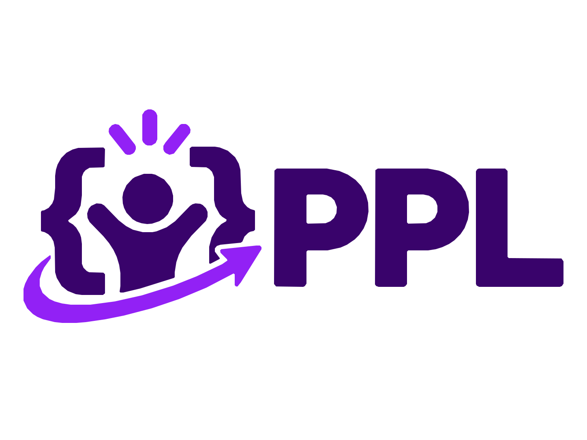

<p align="center">
  <picture>
    <source media="(prefers-color-scheme: dark)" srcset="docs/media/pico-logo-dark.svg">
    
  </picture>
</p>

# Pico Programming Language (`.pi`)

A statically typed, garbage-collected language with **TypeScript-based syntax** that compiles
ahead-of-time to native code on **Linux, macOS and Windows** (x86_64 and arm64) and to
**WebAssembly** (browser and WASI).

TypeScript and JavaScript are the most widely used languages on GitHub, so a familiar syntax with
native performance is meant to feel at home for as many people as possible.

## Goals

- TS look and feel, with **nominal**, sound types (no `any`, no `undefined`, a single `null`)
- Native speed: sized numeric types, `struct` value types, monomorphized generics, LLVM backend
- One tool, `pico`: build, run, test, fmt, package manager, REPL, LSP
- Equally good for CLI tools, servers, games/graphics and the browser

## Status

Specification complete: all 16 chapters are written and every open question is resolved
(162 recorded decisions). Next up is Phase 1, the bootstrap compiler. See [PLAN.md](PLAN.md), [PROGRESS.md](PROGRESS.md), [docs/DECISIONS.md](docs/DECISIONS.md) and
[docs/spec/](docs/spec/).

```ts
const name = "world"
println(`Hello, ${name}!`)
```
